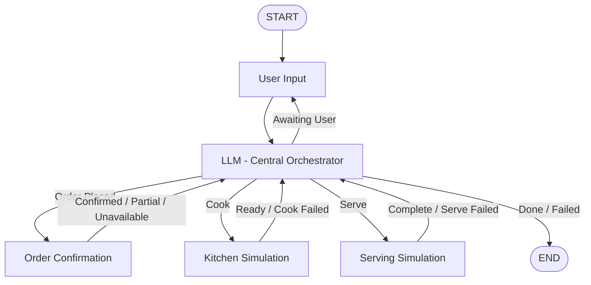

# 🍽️ Restaurant Order Management AI Agent

An autonomous, stateful conversational restaurant ordering system built using **LangGraph, LangChain, and Groq**. The agent manages the complete restaurant ordering lifecycle, from understanding customer requests and validating inventory to simulating kitchen preparation and food delivery.

Designed around a centralized orchestration architecture, the system handles partial stock availability, customer negotiation, probabilistic failures, retry mechanisms, and graceful session termination.

## 🚀 Key Features

- **Intelligent Intent Recognition:** Uses LLM-powered structured output with Pydantic to identify new orders, partial-order acceptance, and unrelated queries.
- **Conversational Guardrails:** Detects out-of-scope requests and redirects conversations toward restaurant ordering.
- **Fuzzy Menu Matching:** Handles spelling mistakes and variations in food names using Python's `difflib`.
- **Inventory Management:** Validates requested quantities against available stock and supports partial availability negotiation.
- **Kitchen Simulation:** Simulates food preparation with configurable success probabilities.
- **Delivery Simulation:** Models serving failures and automatically triggers re-cooking when required.
- **Retry Management:** Maintains independent retry budgets for order confirmation, cooking, and serving.
- **Stateful Orchestration:** Uses LangGraph to maintain conversation history, track order status, and coordinate workflow transitions.
- **Deterministic Testing:** Supports scripted inputs and outcomes to test different success and failure scenarios.

## 🏗️ Architecture

The application follows a **Centralized Brain Architecture**, where the LLM node acts as the primary orchestrator.

Instead of relying on rigid node-to-node transitions, every operational node reports its outcome back to the central LLM node. The orchestrator evaluates the current state, manages retry budgets, interacts with the customer, and determines the next execution step.

### Workflow



### Workflow Components

| Component | Responsibility |
|---|---|
| `user_input` | Captures customer requests and responses |
| `llm` | Extracts intent, manages state, and controls routing |
| `order_confirm` | Validates menu items and inventory |
| `cook` | Simulates kitchen preparation |
| `serve` | Simulates food delivery to the customer |

## 🧠 State Management

The agent maintains a typed state throughout the execution lifecycle.

```python
class State(TypedDict):
    messages: Annotated[list, add_messages]
    order: OrderDetails
    status: Status
    order_retries: int
    cook_retries: int
    serve_retries: int
    final_result: str
```

### Retry Configuration

| Operation | Maximum Attempts |
|---|---:|
| Order Confirmation | 3 |
| Cooking | 2 |
| Serving | 2 |

The system maintains separate retry budgets for each operation. When a retry budget is exhausted, the agent terminates the session gracefully with an appropriate customer-facing message.

## 📋 Default Restaurant Menu

| Dish | Available Quantity | Status |
|---|---:|---|
| Pizza | 5 | In Stock |
| Burger | 3 | In Stock |
| Biryani | 10 | In Stock |
| Dosa | 2 | Low Stock |
| Pasta | 0 | Sold Out |

## 🛠️ Tech Stack

| Technology | Purpose |
|---|---|
| Python 3.12+ | Core application logic |
| LangGraph | Stateful workflow orchestration |
| LangChain | LLM integration |
| Groq Cloud | LLM inference |
| Pydantic | Structured output and validation |
| python-dotenv | Environment variable management |
| uv | Dependency and environment management |

## 📂 Project Structure

```text
restproject/
│
├── main.py              # Main application and LangGraph workflow
├── test_scenarios.py    # Automated test scenarios
├── prompt.md            # Original requirements and specifications
├── pyproject.toml       # Project configuration and dependencies
├── uv.lock              # Dependency lockfile
├── .env                 # API credentials (not committed)
├── .gitignore
└── README.md
```

## ⚙️ Installation & Setup

### Prerequisites

- Python 3.12 or higher
- Groq Cloud API key
- uv package manager (recommended)

### 1. Clone the Repository

```bash
git clone https://github.com/<your-username>/restproject.git
cd restproject
```

### 2. Configure Environment Variables

Create a `.env` file in the project root:

```env
GROQ_API_KEY=your_groq_api_key
```

Get your API key from [Groq Console](https://console.groq.com/).

**Important:** Never commit your `.env` file or expose your API credentials publicly.

### 3. Install Dependencies

Using uv (recommended):

```bash
uv sync
```

Alternatively, using pip:

```bash
python -m venv .venv
```

Activate the environment:

**Windows**
```bash
.venv\Scripts\activate
```

**Linux / macOS**
```bash
source .venv/bin/activate
```

Install dependencies:

```bash
pip install langgraph langchain-groq python-dotenv pydantic
```

## ▶️ Running the Application

Start the interactive restaurant ordering agent:

```bash
uv run main.py
```

Alternatively:

```bash
python main.py
```

### Example Interaction

```text
Welcome! Menu: {
    'pizza': 5,
    'burger': 3,
    'biryani': 10,
    'dosa': 2,
    'pasta': 0
}

Tell me what you'd like to order.

You: I want 2 burgers

Agent: Great! Your order of 2 burgers is
confirmed and sent to the kitchen.

[cook] success -> ready

Agent: Your food is prepared and is
on its way to your table.

[serve] success -> complete

Agent: Here is your order! Enjoy your meal.

FINAL RESULT: COMPLETED
```

*Note: Kitchen and serving outcomes are probabilistic, so actual execution paths may vary.*

## 🧪 Testing

The project includes deterministic test scenarios to validate normal operations, inventory constraints, and failure recovery mechanisms.

Run the test suite:

```bash
uv run test_scenarios.py
```

Or:

```bash
python test_scenarios.py
```

### Test Scenarios

**TC1 – Guardrails and Order Retry Exhaustion**

- Customer starts with an unrelated query.
- Agent redirects the conversation toward food ordering.
- Customer requests more burgers than available.
- Customer declines partial availability and requests an unavailable item.
- System exhausts the order retry budget and terminates gracefully.

**TC2 – Kitchen and Serving Failure Recovery**

- Customer places a valid pizza order.
- Initial cooking attempt fails.
- Agent retries cooking successfully.
- Initial serving attempt fails.
- Agent triggers re-cooking and re-serving.
- Order eventually completes successfully.

**TC3 – Serving Failure with Exhausted Kitchen Budget**

- Customer negotiates and confirms an available order.
- Cooking fails once and succeeds on retry.
- Serving fails, triggering another cooking attempt.
- Subsequent serving also fails.
- Kitchen retry budget is exhausted.
- Agent terminates with an appropriate apology and failure status.

## 🔧 Configuration

The following parameters can be customized in `main.py`:

| Parameter | Description | Default |
|---|---|---|
| `MODEL` | LLM model used through Groq | `openai/gpt-oss-120b` |
| `MENU` | Restaurant inventory | Defined in code |
| `COOK_SUCCESS_PROB` | Probability of successful cooking | `0.6` |
| `SERVE_SUCCESS_PROB` | Probability of successful serving | `0.6` |
| `ORDER_RETRIES` | Order retry budget | `3` |
| `COOK_RETRIES` | Cooking retry budget | `2` |
| `SERVE_RETRIES` | Serving retry budget | `2` |

## 💡 Design Highlights

- **Centralized Decision Making:** Keeps workflow routing and conversational reasoning in one orchestration node.
- **Explicit State Transitions:** Maintains predictable execution through typed state and lifecycle statuses.
- **Failure Recovery:** Handles operational failures without immediately terminating the conversation.
- **Bounded Execution:** Prevents infinite retry loops through independent retry budgets.
- **Testability:** Separates operational logic from scripted test inputs and outcomes.

## 📄 License

This project is licensed under the MIT License. See the [LICENSE](LICENSE) file for details.
